# Документ о концепции и границах кейса

| Поле | Значение |
|------|----------|
| **Кейс** | Переход на электронные договоры и дополнительные соглашения между университетом и студентом (Вариант 03) |
| **Индустриальный партнер** | Учебное управление университета (договорной отдел) |
| **Версия** | `1.0-concept-freeze` |
| **Дата** | 2026-10-21 |
| **Статус** | Согласовано |
| **Авторы** | Сапунков Артемий Романович (гр. ПрИн-366) Блошкин Юрий Викторович (гр. ПрИн-366) |

> [!NOTE]
> Настоящий документ фиксирует бизнес-требования, границы и архитектурные рамки решения по отказу от бумажного оборота образовательных договоров. Документ служит единым источником истины (*single source of truth*) для разработчиков 1С, системных интеграторов ЕПГУ и договорного отдела университета.

---

## 1. Введение

Для учебного и договорного отделов университета, сталкивающихся с длительными бюрократическими задержками при оформлении платного обучения, а также для абитуриентов и студентов, территориально удаленных от кампуса, **Подсистема электронного подписания договоров в «1С:Университет ПРОФ» с интеграцией ЕПГУ / «Госключ»** — это программный контур автоматизации юридически значимого документооборота. 

Решение обеспечивает автоматическое формирование неизменяемых печатных форм (PDF/A) из актуальных учетных данных 1С, подписание их усиленной квалифицированной электронной подписью (УКЭП) со стороны уполномоченного лица вуза, защищенную передачу на ЕПГУ в мобильное приложение «Госключ», подписание второй стороной (УНЭП/УКЭП) и автоматический возврат юридически значимого подписанного пакета (PDF + отсоединенные PKCS#7 подписи) непосредственно в карточку исходного объекта «1С:Университет ПРОФ».

В отличие от текущей практики физического согласования бумажных документов по кабинетам университета и ожидания очного визита студента, решение исключает промежуточные звенья логистики, полностью исключает ручной повторный ввод данных и сокращает сквозной цикл заключения договора с 7–14 рабочих дней до нескольких часов.

---

## 2. Бизнес-контекст и цели

### 2.1. Исходные данные (Состояние «Как есть» / As-Is)

В текущей операционной деятельности университета договорной процесс сопряжен со следующими критическими издержками:
1. **Разрозненность шаблонов:** Различные кафедры, институты и юристы используют несогласованные версии файлов Word, что приводит к регулярным ошибкам в формулировках, реквизитах и суммах.
2. **Физический обход кабинетов:** После печати проект договора физически переносится между ответственными лицами: экономист (проверка стоимости) → юрист (проверка условий) → учебное управление (проверка плана) → проректор/ректор (визирование и подписание). Внутренний маршрут занимает **до 5–7 рабочих дней** только со стороны университета.
3. **Ожидание студента / заказчика:** Обучающиеся (особенно заочной, очно-заочной формы и иногородние) вынуждены лично прибывать в университет для простановки подписи либо пересылать бумажные экземпляры почтой (задержка до 2–3 недель).
4. **Вторичная оцифровка и архивные потери:** После возвращения подписанного экземпляра сотрудники сканируют документ для прикрепления к учетным системам, а бумагу подшивают в номенклатурные папки. Сканирование и ручная проверка отнимают до 15% рабочего времени сотрудников договорного отдела.

### 2.2. Возможности бизнеса (Состояние «Как будет» / To-Be)

Внедрение прямого контура электронного подписания вокруг объекта `Справочник.ДоговорыНаОказаниеОбразовательныхУслуг` и `Справочник.ДополнительныеСоглашенияКДоговорамОбучения` в конфигурации «1С:Университет ПРОФ» обеспечивает:
- Исключение 100% бумажных носителей и расходов на канцелярию/пересылку для типовых договоров;
- Контроль актуальности условий договора на программном уровне (невозможно подделать текст или суммы, так как печатная форма генерируется сервером из утвержденного макета);
- Мгновенную доставку документа в подтвержденную учетную запись гражданина на ЕПГУ через государственную инфраструктуру («Госключ»);
- Автоматический трекинг статуса в карточке 1С: сотрудник видит каждый этап (отправлен, просмотрен, подписан, отклонен, ошибка доставки);
- Создание юридически неоспоримой доказательной базы в строгом соответствии с 63-ФЗ («Об электронной подписи») и 152-ФЗ («О персональных данных»).

### 2.3. Бизнес-цели

| ID | Цель | Масштаб | Способ измерения | База (As-Is) | План (To-Be) | Обязательный порог | Срок достижения |
|----|------|---------|------------------|--------------|--------------|-------------------|-----------------|
| **BO-1** | Сократить средний срок подписания договора обеими сторонами | Все заключаемые договоры и доп. соглашения на обучение | Исследование временных меток от создания проекта договора до статуса «Подписан обеими сторонами» | 7–14 дней | $\le 24$ часов | $\le 48$ часов | 3 месяца после ввода в промышленную эксплуатацию |
| **BO-2** | Устранить трудозатраты на перемещение бумаг и повторное сканирование | Договорной отдел и учебное управление | Замер рабочего времени сотрудников на операционную работу с договором | 40 минут / договор | $\le 3$ минут / договор | $\le 5$ минут / договор | 2 месяца после запуска |
| **BO-3** | Обеспечить долю договоров, заключенных в электронном виде через Госключ | Все договоры со студентами 1 курса платной формы | Отношение электронных договоров к общему числу заключенных договоров за приемную кампанию | 0% | $\ge 85\%$ | $\ge 70\%$ | По итогам первой приемной кампании |
| **BO-4** | Снизить количество юридических коллизий и расхождений в текстах договоров | Юридическая служба университета | Аудит договоров на соответствие типовым формам | До 4% договоров с правками | 0% | 0% | С момента релиза 1.0 |

### 2.4. Видение решения

> **Для** сотрудников договорного отдела и студентов университета,  
> **которым** необходимо оперативно и юридически чисто заключать договоры и дополнительные соглашения на оказание платных образовательных услуг,  
> **Подсистема электронного подписания 1С–ЕПГУ** —  
> **это** специализированное интеграционное расширение «1С:Университет ПРОФ»,  
> **которое** обеспечивает автоматическую генерацию канонического PDF-документа, подписание УКЭП вуза, сквозную отправку на ЕПГУ в мобильное приложение «Госключ» и бесшовное прикрепление ответной электронной подписи студента к карточке договора.  
> **В отличие от** разрозненного бумажного документооборота или внешних коммерческих систем КЭДО, требующих дублирования справочников и регистрации в сторонних ЛК,  
> **наше решение** встроено в привычный рабочий интерфейс «1С:Университет ПРОФ», использует готовые реквизиты студента и учебного плана и опирается на бесплатный для гражданина государственный сервис «Госключ».

---

## 3. Стейкхолдеры

### 3.1. Профили заинтересованных лиц

| Заинтересованное лицо | Основная ценность | Отношение | Основные интересы | Ограничения |
|-----------------------|-------------------|-----------|-------------------|-------------|
| **Сотрудники договорного отдела / учебного управления** | Ликвидация рутины (распечатка, обход кабинетов, сбор подписей, сканирование); прозрачность статусов | Высокая поддержка | Простота работы (1–2 кнопки в знакомом интерфейсе 1С), автоматический возврат файлов, наглядная индикация статусов | Запрет на усложнение карточки договора, нежелание работать во внешних веб-интерфейсах |
| **Юридическая служба университета** | 100% юридическая чистота формулировок, неизменяемость шаблона, юридическая сила электронной подписи | Умеренная поддержка / осторожность | Соответствие 63-ФЗ, регламентам Минобрнауки РФ, надежная фиксация полномочий подписанта | Необходимость хранения отсоединенных подписей и штампов визуализации ЭП в PDF |
| **Уполномоченный подписант (Ректор / Проректор)** | Быстрое массовое или пакетное подписание без необходимости подписывать сотни бумажных листов вручную | Высокая поддержка | Безопасность закрытого ключа УКЭП, гарантия соответствия подписываемого текста утвержденной форме | Ограниченное время, строгие требования к криптопровайдеру (КриптоПро CSP) |
| **Студенты и их законные представители (плательщики)** | Возможность заключить договор из любой точки РФ без личного визита в вуз, отсутствие расходов на нотариусов/почту | Высокий энтузиазм | Понятный интерфейс на портале Госуслуг и в приложении «Госключ», защищенность данных | Необходимость наличия подтвержденной учетной записи ЕСИА и смартфона с NFC / биометрией для УКЭП/УНЭП |
| **ИТ-служба университета** | Надежная интеграционная архитектура, отсутствие необходимости поддерживать отдельную СУБД/веб-сервер | Поддержка с фокусом на отказоустойчивость | Автоматизация фонового обмена с ЕПГУ, логирование ошибок API, сохранение целостности базы 1С | Ограничения пропускной способности API ЕПГУ, регламенты безопасности каналов связи |

### 3.2. Матрица влияния и интереса

| Стейкхолдер | Влияние | Интерес | Стратегия работы |
|-------------|---------|---------|------------------|
| **Учебное / договорное управление** | Высокое | Высокое | **Тесное взаимодействие:** ключевой заказчик логики работы, совместное тестирование интерфейса 1С |
| **ИТ-служба и системный интегратор** | Высокое | Высокое | **Управление реализацией:** проектирование API-клиента, криптографии и регламентных заданий |
| **Юридическая служба** | Высокое | Среднее | **Удовлетворение требований:** согласование шаблонов, юридической схемы подписания и правил 63-ФЗ |
| **Студенты / Заказчики** | Среднее | Высокое | **Информирование и сопровождение:** разработка наглядных памяток по подписанию в «Госключе» |
| **Бухгалтерия (финансовый отдел)** | Среднее | Низкое | **Мониторинг:** предоставление факта утверждения договора для последующего контроля оплат |

---

## 4. Функциональные требования

### 4.1. Перечень основных функций

| ID | Функция | Краткое описание |
|----|---------|------------------|
| **FE-1** | Генерация неизменяемой печатной формы договора / доп. соглашения | Сборка канонического документа в формате PDF/A из реквизитов объекта 1С по единому макету |
| **FE-2** | Локальное подписание документа УКЭП университета | Формирование отсоединенной электронной подписи PKCS#7 (`.sig`) с использованием сертификата вуза через КриптоПро CSP |
| **FE-3** | Отправка пакета документов на подписание в ЕПГУ («Госключ») | Вызов REST API ЕПГУ (`POST /v1/orders`), передача метаданных, PDF-документа, подписи вуза и идентификатора гражданина (СНИЛС / OID ЕСИА) |
| **FE-4** | Асинхронный опрос и обработка статусов подписания | Фоновое регламентное задание 1С, опрашивающее ЕПГУ (`GET /v1/orders/{orderId}`) и обновляющее реквизит `СостояниеЭП` |
| **FE-5** | Загрузка и фиксация ответной подписи студента | Скачивание файла подписи обучающегося/заказчика из ЕПГУ, сохранение в реквизит `ПодписьСтудента` и перевод договора в состояние `Утвержден` |
| **FE-6** | Визуализация штампов электронных подписей | Формирование отображаемой версии PDF со штампами ЭП обеих сторон (номер сертификата, владелец, период действия) для печати по требованию |
| **FE-7** | Обработка отказов, истечения срока и аннулирования | Корректный перевод договора в соответствующий статус при отказе студента в «Госключе» или таймауте (14 календарных дней) с уведомлением оператора |

### 4.2. Дерево функций

```mermaid
flowchart TB
  subgraph System["Подсистема электронного подписания 1С–ЕПГУ"]
    F1["1. Формирование документа"]
    F2["2. Подписание вузом"]
    F3["3. Интеграция с ЕПГУ"]
    F4["4. Фиксация результата"]
    F5["5. Администрирование и аудит"]
  end

  F1 --> F11["Генерация PDF/A из макета 1С"]
  F1 --> F12["Проверка обязательных реквизитов (СНИЛС, паспорт, сумма)"]
  F1 --> F13["Блокировка редактирования полей карточки"]

  F2 --> F21["Выбор криптопровайдера (КриптоПро CSP)"]
  F2 --> F22["Создание отсоединенной УКЭП вуза (.sig)"]
  F2 --> F23["Сохранение подписи в хранилище объекта 1С"]

  F3 --> F31["Формирование JSON-пакета запроса API ЕПГУ"]
  F3 --> F32["Отправка заявления (POST /v1/orders)"]
  F3 --> F33["Регламентный опрос статусов (GET /v1/orders/{orderId})"]
  F3 --> F34["Обработка ошибок транспорта и валидации API"]

  F4 --> F41["Загрузка подписи студента из Госключа"]
  F4 --> F42["Валидация целостности и цепочки сертификата"]
  F4 --> F43["Автоматический перевод договора в 'Утвержден'"]
  F4 --> F44["Формирование PDF со штампами визуализации ЭП"]

  F5 --> F51["Журналирование событий обмена (лог API)"]
  F5 --> F52["Оповещение оператора о сбоях и отказах"]
```

### 4.3. Варианты использования по ролям

| Роль | Варианты использования |
|------|------------------------|
| **Оператор договорного отдела** | • UC-1: Инициация подписания договора и отправка на ЕПГУ • UC-2: Ручной запрос текущего статуса подписания по договору • UC-3: Просмотр и выгрузка подписанного комплекта (PDF + sig) • UC-4: Отзыв (аннулирование) отправленного на ЕПГУ заявления |
| **Студент / Плательщик** | • UC-5: Получение push-уведомления на ЕПГУ и в мобильном приложении «Госключ» • UC-6: Ознакомление с текстом договора в мобильном приложении • UC-7: Подписание документа в приложении «Госключ» личным сертификатом ЭП • UC-8: Мотивированный отказ от подписания документа |
| **Системный администратор / Фоновое задание** | • UC-9: Автоматическая синхронизация статусов с ЕПГУ по расписанию • UC-10: Диагностика интеграционного шлюза и мониторинг журналов обмена |

---

### 4.4. Детальные сценарии использования

#### UC-1. Инициация формирования, подписания вузом и отправки договора на ЕПГУ

| Поле | Значение |
|------|----------|
| **Идентификатор и название** | **UC-1. Инициация подписания договора и отправка на ЕПГУ** |
| **Авторы** | Сапунков А. Р., Блошкин Ю. В. |
| **Дата создания** | 2026-10-21 |
| **Основное действующее лицо** | Оператор договорного отдела (сотрудник университета) |
| **Второстепенные действующие лица** | Система «1С:Университет ПРОФ», КриптоПро CSP, Сервер интеграции ЕПГУ («Госключ») |
| **Описание** | Оператор инициирует процедуру электронного заключения договора из карточки 1С. Система проверяет полноту данных, генерирует PDF-файл, подписывает его локальным сертификатом УКЭП университета и передает в API ЕПГУ для доставки студенту в приложение «Госключ» |
| **Условие-триггер** | Нажатие кнопки «Подписать и отправить на ЕПГУ» в командной панели карточки договора |
| **Предусловия (Pre-conditions)** | 1. Договор находится в состоянии `Проект`. 2. Заполнены все обязательные реквизиты (обучающийся, плательщик, учебный план, сумма, график платежей). 3. В карточке физлица заполнен корректный СНИЛС (11 цифр) и паспортные данные. 4. На сервере 1С установлен и настроен действующий сертификат УКЭП вуза и КриптоПро CSP. 5. Учетная запись шлюза ЕПГУ активна. |
| **Постусловия (Post-conditions)** | 1. Реквизит `СостояниеЭП` принимает значение `ОтправленВГосключ`. 2. Заполнены `ДатаПодписиУниверситета`, `ДатаОтправкиНаЕПГУ`, `ИдентификаторЗаявленияЕПГУ`. 3. В реквизитах `ФайлПечатнойФормы` и `ПодписьУниверситета` сохранены бинарные данные PDF и .sig. 4. В приложении «Госключ» у студента появилось входящее уведомление о подписании. |
| **Приоритет** | Высокий (критический функционал) |
| **Частота вызова** | Десятки и сотни раз в день в период приемной кампании |
| **Бизнес-правила** | **BR-1:** Текст формируется строго по утвержденному макету печатной формы. **BR-2:** После отправки изменение любых реквизитов договора блокируется до завершения процедуры. **BR-3:** Сертификат вуза должен быть квалифицированным (УКЭП). |

**Нормальный ход событий (Main Success Scenario):**
1. Оператор открывает карточку договора в состоянии `Проект` и проверяет реквизиты.
2. Оператор нажимает команду «Подписать и отправить на ЕПГУ».
3. Система 1С выполняет валидацию данных:
   - Проверяет заполненность СНИЛС студента/плательщика, строк графика платежей и общей стоимости.
4. Система 1С генерирует печатную форму договора в формате PDF/A в оперативной памяти (без сохранения на локальный диск пользователя).
5. Система вызывает серверный криптографический модуль 1С (`КриптоПро CSP`), который формирует отсоединенную подпись PKCS#7 (`.sig`) закрытым ключом университета.
6. Система сохраняет бинарные данные PDF и подписи вуза в реквизиты `ФайлПечатнойФормы` и `ПодписьУниверситета`.
7. Система формирует JSON-запрос к API ЕПГУ (`POST /v1/orders`), передавая метаданные документа, идентификатор получателя (СНИЛС) и файлы в base64.
8. API ЕПГУ регистрирует заявление, возвращает HTTP 201 Created и уникальный номер заявления `orderId`.
9. Система записывает `orderId` в реквизит `ИдентификаторЗаявленияЕПГУ`, фиксирует дату отправки, устанавливает статус `СостояниеЭП = ОтправленВГосключ` и выводит оператору информационное сообщение «Договор успешно подписан вузом и направлен в Госключ».

**Альтернативные потоки:**
- **ALT-1. Плательщиком выступает третье лицо (родитель/заказчик):**
  - На шаге 3 система определяет, что `ИсточникФинансирования` $\ne$ `Обучающийся`.
  - В качестве адресата для Госключа подставляется СНИЛС плательщика (законного представителя).
  - Дальнейшие шаги выполняются штатно.

**Исключительные ситуации (Exception Flows):**
- **EXC-1. Не заполнен СНИЛС или реквизиты студента:**
  - На шаге 3 система выявляет отсутствие СНИЛС или неверную контрольную сумму.
  - Процесс прерывается. Выводится понятная диагностика: «Невозможно отправить документ: не указан корректный СНИЛС физлица». Статус объекта не меняется.
- **EXC-2. Ошибка криптопровайдера (истек сертификат вуза):**
  - На шаге 5 криптомодуль возвращает код ошибки (сертификат отозван/просрочен).
  - Процесс останавливается. В системный журнал пишется запись об ошибке. Оператору отображается предупреждение: «Ошибка формирования УКЭП университета. Обратитесь к системному администратору».
- **EXC-3. Недоступность API ЕПГУ (сетевой сбой или таймаут):**
  - На шаге 8 API ЕПГУ возвращает ошибку 5xx или запрос завершается по таймауту.
  - Подписанный PDF сохраняется в объекте. Статус устанавливается в `ОшибкаОтправкиЕПГУ`. В реквизит `КомментарийЕПГУ` записывается текст технической ошибки. Оператор получает кнопку «Повторить отправку на ЕПГУ».

---

#### UC-4. Асинхронная обработка результата подписания второй стороной

| Поле | Значение |
|------|----------|
| **Идентификатор и название** | **UC-4. Асинхронная фиксация подписи студента** |
| **Основное действующее лицо** | Регламентное фоновое задание 1С |
| **Описание** | Фоновый процесс регулярно проверяет статус заявлений на ЕПГУ. При подписании студентом скачивает подпись, валидирует ее и переводит договор в статус «Утвержден» |

**Краткий сценарий:**
1. Фоновое задание запускается каждые 15 минут, выбирая договоры со статусом `ОтправленВГосключ`.
2. По каждому договору выполняется запрос к ЕПГУ `GET /v1/orders/{orderId}`.
3. ЕПГУ возвращает статус `SIGNED` и вложение с отсоединенной подписью студента.
4. Система 1С сохраняет подпись в реквизит `ПодписьСтудента`, фиксирует дату подписи, изменяет `СостояниеЭП = ПодписанОбеимиСторонами` и переводит договор в основное состояние `Утвержден`.
5. Если получен статус `REJECTED` (студент отклонил) или `EXPIRED` (истек срок действия предложения 14 дней), статус меняется на `ОтклоненСтудентом` / `ПросроченПодписанием`, формируется задача сотруднику договорного отдела.

---

## 5. Нефункциональные требования (NFR)

### 5.1. Безопасность и соответствие законодательству (Security & Compliance)
- **NFR-S1:** Полное соответствие Федеральному закону № 63-ФЗ «Об электронной подписи». Со стороны университета используется усиленная квалифицированная электронная подпись (УКЭП). Со стороны физического лица допускается применение усиленной неквалифицированной электронной подписи (УНЭП) сертификата Госключа либо УКЭП.
- **NFR-S2:** Защита персональных данных в соответствии с Федеральным законом № 152-ФЗ. Все каналы взаимодействия с ЕПГУ защищены по протоколам TLS с использованием ГОСТ-алгоритмов шифрования.
- **NFR-S3:** Неизменяемость документа. Сформированный PDF/A хэшируется, и подписи формируются строго на неизменяемый хэш содержимого файла.

### 5.2. Производительность и масштабируемость (Performance)
- **NFR-P1:** Время генерации печатной формы PDF/A и формирования УКЭП вуза на сервере 1С не должно превышать **3.0 секунд** для одного документа.
- **NFR-P2:** Время синхронного вызова отправки в API ЕПГУ при штатной работе шлюза не должно превышать **5.0 секунд**.
- **NFR-P3:** Подсистема должна обеспечивать пакетную обработку до **1 500 договоров в сутки** в пиковые дни приемной кампании без деградации времени отклика других пользователей 1С.

### 5.3. Надежность и доступность (Reliability & Availability)
- **NFR-R1:** Гарантированная доставка и отказоустойчивость. В случае сбоя сети или временной недоступности ЕПГУ система должна сохранять сформированный подписанный пакет локально в 1С и производить автоматические повторные попытки отправки по алгоритму экспоненциальной задержки.
- **NFR-R2:** Целостность данных. Исключается рассинхронизация: перевод договора в статус `Утвержден` возможен только после успешной верификации и сохранения ответной подписи студента.

### 5.4. Совместимость с IT-ландшафтом (Interoperability)
- **NFR-I1:** Решение реализуется как расширение/модуль конфигурации «1С:Университет ПРОФ» на платформе 1С:Предприятие 8.3 без снятия типовой конфигурации с полной поддержки поставщика.
- **NFR-I2:** Криптографические операции на стороне сервера 1С выполняются через штатный интерфейс криптографии с использованием СКЗИ «КриптоПро CSP» версии 5.0 R2 и выше.

---

## 6. Границы кейса (Scope Management)

### 6.1. Входит в объем проекта (In Scope — Выпуск 1.0)

1. Разработка универсального механизма генерации типового договора на платное обучение и типового дополнительного соглашения об изменении стоимости в формате PDF/A;
2. Реализация механизма локального формирования УКЭП вуза на сервере 1С с сохранением отсоединенной подписи `.sig` в карточке объекта;
3. Разработка программного клиента к REST API ЕПГУ для отправки документов физическому лицу по СНИЛС в мобильное приложение «Госключ»;
4. Фоновое регламентное задание проверки статусов документов на ЕПГУ;
5. Механизм автоматического приема ответной подписи студента и перевод договора в состояние `Утвержден`;
6. Формирование визуального представления документа (PDF) с наложением штампов электронных подписей обеих сторон;
7. Обработка сценариев ошибок: отказ студента, истечение таймаута (14 дней), технические ошибки валидации API.

### 6.2. Не входит в объем проекта (Out of Scope — Будущие выпуски)

1. Изменение логики расчета стоимости обучения, учебных планов и начисления графиков платежей в 1С:Университет ПРОФ (используются существующие механизмы конфигурации);
2. Создание отдельного веб-портала или «Личного кабинета студента для подписи» (подписание второй стороной производится исключительно в приложении «Госключ»);
3. Документы трехсторонних договоров с юридическими лицами (предприятиями-работодателями) через коммерческие операторы ЭДО (СБИС, Диадок) — перенесено в выпуск 2.0;
4. Автоматическая онлайн-оплата первого транша по договору непосредственно в момент подписания в Госключе — отложено в выпуск 2.0;
5. Замена или модернизация учетной системы «1С:Университет ПРОФ».

---

## 7. Ограничения и допущения

### 7.1. Ограничения (Constraints)
- **CON-1:** Вторая сторона (обучающийся или родитель-плательщик) обязана иметь подтвержденную учетную запись на портале Госуслуг (ЕСИА) и установленное приложение «Госключ».
- **CON-2:** Доработка 1С должна вестись в рамках модульной архитектуры типовой конфигурации без нарушения базовых бизнес-процессов утверждения договоров.
- **CON-3:** Для формирования УКЭП университета требуется наличие действующего квалифицированного сертификата руководителя вуза (или лица по машиночитаемой доверенности МЧД) и лицензии СКЗИ «КриптоПро CSP».

### 7.2. Допущения (Assumptions)
- **ASM-1:** Серверное окружение 1С имеет прямой защищенный доступ к интеграционному контуру ЕПГУ (СМЭВ / шлюз Госключа).
- **ASM-2:** Все персональные данные, необходимые для формирования договора и отправки в Госключ (ФИО, паспортные данные, СНИЛС), корректно внесены в 1С на этапе приемной комиссии / подачи заявления.

---

## 8. Риски и план их снижения (Mitigation)

| ID | Описание риска | Вероятность | Ущерб | План снижения (митигация) |
|----|----------------|-------------|-------|---------------------------|
| **RSK-1** | Отсутствие у абитуриента/родителя подтвержденной записи ЕСИА или приложения «Госключ» | Высокая | Средний | Разработка наглядных инструкций и видеороликов при подаче документов; сохранение альтернативного очного подписания как резервного канала для исключительных случаев |
| **RSK-2** | Недоступность или регламентные работы на шлюзе ЕПГУ / Госключа в пик приемной кампании | Средняя | Высокий | Буферизация исходящих пакетов в 1С; очередь повторной отправки; регламентный мониторинг доступности шлюза; увеличение таймаутов опроса |
| **RSK-3** | Ошибки во введенных оператором данных СНИЛС, приводящие к невозможности доставки в Госключ | Средняя | Средний | Программная проверка формата и контрольного числа СНИЛС по алгоритму валидации прямо в интерфейсе 1С до генерации подписи и отправки |
| **RSK-4** | Смена сертификата УКЭП вуза без своевременного обновления в контуре 1С | Низкая | Высокий | Настройка автоматического предупреждения ответственного администратора в 1С за 30, 14 и 3 дня до окончания срока действия сертификата |

---

## 9. Критерии приемки (KPI и метрики успеха)

Проект признается успешно выполненным и принимается заказчиком при достижении следующих объективных критериев:

| ID | Критерий приемки | Метод подтверждения |
|----|------------------|----------------------|
| **AC-1** | Договор и доп. соглашение формируются в виде неизменяемого PDF/A по единому макету из карточки 1С в один клик | Демонстрация генерации документов из справочника `ДоговорыНаОказаниеОбразовательныхУслуг` без ручной правки Word-файлов |
| **AC-2** | Подписание УКЭП вуза и передача в ЕПГУ производятся программно без выгрузки файлов на диск и без промежуточных бумажных согласований | Контрольный прогон отправки тестового договора в контур «Госключ» |
| **AC-3** | Удаленное подписание документа физическим лицом в приложении «Госключ» | Успешное подписание тестовым пользователем со смартфона |
| **AC-4** | Автоматический возврат подписи студента и перевод договора в состояние `Утвержден` | Фиксация файлов подписей в реквизитах `ПодписьУниверситета` и `ПодписьСтудента` объекта 1С и смена статуса без участия оператора |
| **AC-5** | Сквозное время прохождения полного цикла подписания составляет менее 24 часов при наличии активности со стороны студента | Замер времени на контрольной выборке из 50 реальных договоров |
